# PLAYORA end-to-end journeys

Each path links to designed views. Staff/customer handoffs represent different authorized people; prototype navigation is not an authorization model. Branches must be checked before implementation acceptance.

## F01 — Custom boost: browse to completion

[P01](design/index.html#P01) → [G01](design/index.html#G01) → [P04](design/index.html#P04) → [P05](design/index.html#P05) → [I01](design/index.html#I01) → [I02](design/index.html#I02) → [P05](design/index.html#P05) → [P06](design/index.html#P06) → [C02](design/index.html#C02) → [C03](design/index.html#C03) → [P09](design/index.html#P09) → [P10](design/index.html#P10) → [P11](design/index.html#P11) → [C04](design/index.html#C04) → [C06](design/index.html#C06) → [C05](design/index.html#C05) → [C16](design/index.html#C16)

```mermaid
flowchart LR
  n0["P01 · Your next level starts here."]
  n1["G01 · Mobile Legends"]
  n2["P04 · Build your Mobile Legends boost."]
  n3["P05 · Review your request."]
  n4["I01 · Welcome to PLAYORA."]
  n5["I02 · Check your email."]
  n6["P05 · Review your request."]
  n7["P06 · Your request is with our team."]
  n8["C02 · Your orders."]
  n9["C03 · Your quote is ready."]
  n10["P09 · Choose how to pay."]
  n11["P10 · Complete your payment."]
  n12["P11 · We’re confirming your payment."]
  n13["C04 · Let’s get your order ready."]
  n14["C06 · Plan your play session."]
  n15["C05 · Your boost is in progress."]
  n16["C16 · Review your experience."]
  n0 --> n1
  n1 --> n2
  n2 --> n3
  n3 --> n4
  n4 --> n5
  n5 --> n6
  n6 --> n7
  n7 --> n8
  n8 --> n9
  n9 --> n10
  n10 --> n11
  n11 --> n12
  n12 --> n13
  n13 --> n14
  n14 --> n15
  n15 --> n16
```

**Branches and guards**

- Game service links use nested design fragments so the hero, statistics and background remain mounted during configuration/review. My account/order destinations intentionally leave the game shell.
- P01 service introductions scroll to the bottom game selection. G01 starts with large service cards; selecting Boost opens only Boost while preserving the game hero. Back to choose service returns to the cards.
- Invalid ranks stay in P04 with field errors.
- Manual estimate can submit without a numeric promise.
- Clarification returns to C03/C12.
- Quote change or expiry requires fresh review.
- Staff approval is required for quote and completion.
- Panel revision: enter the named record; change local sections without leaving its role/identity; return to the filtered parent list. Admin previews return to the exact originating editor. See PANEL_UX_REVISION.md.

**Completion evidence:** Verified payment, fulfilled scope, evidence and eligible review; not success from a browser redirect.

## F02 — Fixed package purchase

[G01](design/index.html#G01) → [P07](design/index.html#P07) → [P08](design/index.html#P08) → [I01](design/index.html#I01) → [I02](design/index.html#I02) → [P08](design/index.html#P08) → [P09](design/index.html#P09) → [P10](design/index.html#P10) → [P11](design/index.html#P11) → [C04](design/index.html#C04) → [C05](design/index.html#C05)

```mermaid
flowchart LR
  n0["G01 · Mobile Legends"]
  n1["P07 · Rank progress package."]
  n2["P08 · Check your package details."]
  n3["I01 · Welcome to PLAYORA."]
  n4["I02 · Check your email."]
  n5["P08 · Check your package details."]
  n6["P09 · Choose how to pay."]
  n7["P10 · Complete your payment."]
  n8["P11 · We’re confirming your payment."]
  n9["C04 · Let’s get your order ready."]
  n10["C05 · Your boost is in progress."]
  n0 --> n1
  n1 --> n2
  n2 --> n3
  n3 --> n4
  n4 --> n5
  n5 --> n6
  n6 --> n7
  n7 --> n8
  n8 --> n9
  n9 --> n10
```

**Branches and guards**

- Ineligible package offers compatible/custom alternatives.
- Sold-out/paused package blocks new purchase.
- Version or price changes return to explicit review.
- Panel revision: enter the named record; change local sections without leaving its role/identity; return to the filtered parent list. Admin previews return to the exact originating editor. See PANEL_UX_REVISION.md.

**Completion evidence:** Package snapshot accepted and verified payment; no per-order quote approval.

## F03 — Account purchase & secure receipt

[P12](design/index.html#P12) → [P13](design/index.html#P13) → [P14](design/index.html#P14) → [I01](design/index.html#I01) → [I02](design/index.html#I02) → [P14](design/index.html#P14) → [P09](design/index.html#P09) → [P10](design/index.html#P10) → [P11](design/index.html#P11) → [C23](design/index.html#C23) → [A26](design/index.html#A26) → [I08](design/index.html#I08) → [C23](design/index.html#C23)

```mermaid
flowchart LR
  n0["P12 · Find your next account."]
  n1["P13 · Mythic account · Mobile Legends"]
  n2["P14 · Review your account purchase."]
  n3["I01 · Welcome to PLAYORA."]
  n4["I02 · Check your email."]
  n5["P14 · Review your account purchase."]
  n6["P09 · Choose how to pay."]
  n7["P10 · Complete your payment."]
  n8["P11 · We’re confirming your payment."]
  n9["C23 · Your purchased account."]
  n10["A26 · Buyer account delivery."]
  n11["I08 · Open your private handoff."]
  n12["C23 · Your purchased account."]
  n0 --> n1
  n1 --> n2
  n2 --> n3
  n3 --> n4
  n4 --> n5
  n5 --> n6
  n6 --> n7
  n7 --> n8
  n8 --> n9
  n9 --> n10
  n10 --> n11
  n11 --> n12
```

**Branches and guards**

- Reservation conflict means no invoice.
- Expired reservation requires availability recheck.
- Late paid reservation enters a case, never steals sold inventory.
- Panel revision: enter the named record; change local sections without leaving its role/identity; return to the filtered parent list. Admin previews return to the exact originating editor. See PANEL_UX_REVISION.md.

**Completion evidence:** Verified payment, audited transfer and required acknowledgement.

## F04 — Invoice recovery & exceptions

[P09](design/index.html#P09) → [P10](design/index.html#P10) → [P11](design/index.html#P11) → [C07](design/index.html#C07) → [C08](design/index.html#C08) → [C09](design/index.html#C09)

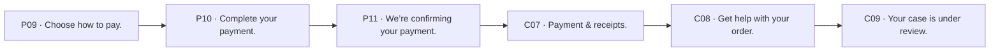

**Branches and guards**

- Paused checkout stays unpaid.
- Uncertain invoice creation reconciles before retry.
- Under/over/late/wrong-network/duplicate funds remain separate states.
- Expired invoice with detected funds cannot release inventory blindly.
- Panel revision: enter the named record; change local sections without leaving its role/identity; return to the filtered parent list. Admin previews return to the exact originating editor. See PANEL_UX_REVISION.md.

**Completion evidence:** Authoritative evidence resolves payment or explicit refund review.

## F05 — Cancellation, dispute & refund

[C05](design/index.html#C05) → [C08](design/index.html#C08) → [C09](design/index.html#C09) → [A16](design/index.html#A16) → [I06](design/index.html#I06) → [A19](design/index.html#A19) → [C07](design/index.html#C07)

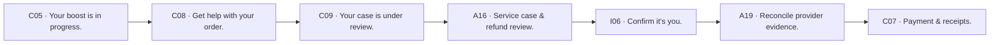

**Branches and guards**

- Unpaid cancellation retires eligible invoice.
- Paid cancellation is a request, not an immediate refund.
- Recipient changes require review; outgoing disabled blocks transfer.
- Denied remedy exposes approved appeal terms.
- Panel revision: enter the named record; change local sections without leaving its role/identity; return to the filtered parent list. Admin previews return to the exact originating editor. See PANEL_UX_REVISION.md.

**Completion evidence:** Recorded decision and verified outgoing evidence where applicable.

## F06 — Seller consignment

[S01](design/index.html#S01) → [S02](design/index.html#S02) → [S03](design/index.html#S03) → [S07](design/index.html#S07) → [A20](design/index.html#A20) → [A37](design/index.html#A37) → [A21](design/index.html#A21) → [S04](design/index.html#S04) → [S05](design/index.html#S05) → [A22](design/index.html#A22) → [A23](design/index.html#A23) → [P13](design/index.html#P13) → [C23](design/index.html#C23) → [A17](design/index.html#A17) → [S06](design/index.html#S06)

```mermaid
flowchart LR
  n0["S01 · Your account sales."]
  n1["S02 · Tell us about your account."]
  n2["S03 · Submission SA-204."]
  n3["S07 · SA-204 · Private seller messages"]
  n4["A20 · Account submissions."]
  n5["A37 · SA-204 · Seller conversation"]
  n6["A21 · Review submission SA-204."]
  n7["S04 · Review your sale offer."]
  n8["S05 · Secure account handover."]
  n9["A22 · Account inventory."]
  n10["A23 · Edit account listing AC-208."]
  n11["P13 · Mythic account · Mobile Legends"]
  n12["C23 · Your purchased account."]
  n13["A17 · Seller payout review."]
  n14["S06 · Your direct payout."]
  n0 --> n1
  n1 --> n2
  n2 --> n3
  n3 --> n4
  n4 --> n5
  n5 --> n6
  n6 --> n7
  n7 --> n8
  n8 --> n9
  n9 --> n10
  n10 --> n11
  n11 --> n12
  n12 --> n13
  n13 --> n14
```

**Branches and guards**

- More proof returns to S03.
- Changed offer requires new acceptance.
- Payout waits for agreed delivery/dispute conditions.
- Related refunds/disputes can hold payout.
- Panel revision: enter the named record; change local sections without leaving its role/identity; return to the filtered parent list. Admin previews return to the exact originating editor. See PANEL_UX_REVISION.md.

**Completion evidence:** Direct payout confirmed under the accepted consignment terms.

## F07 — Buy-first acquisition

[S02](design/index.html#S02) → [S03](design/index.html#S03) → [A21](design/index.html#A21) → [S04](design/index.html#S04) → [S05](design/index.html#S05) → [A17](design/index.html#A17) → [S06](design/index.html#S06) → [A23](design/index.html#A23)

```mermaid
flowchart LR
  n0["S02 · Tell us about your account."]
  n1["S03 · Submission SA-204."]
  n2["A21 · Review submission SA-204."]
  n3["S04 · Review your sale offer."]
  n4["S05 · Secure account handover."]
  n5["A17 · Seller payout review."]
  n6["S06 · Your direct payout."]
  n7["A23 · Edit account listing AC-208."]
  n0 --> n1
  n1 --> n2
  n2 --> n3
  n3 --> n4
  n4 --> n5
  n5 --> n6
  n6 --> n7
```

**Branches and guards**

- Choose Buy first explicitly in A21 and display it in S04.
- Payment becomes due after verified seller-to-PLAYORA transfer, before resale.
- Panel revision: enter the named record; change local sections without leaving its role/identity; return to the filtered parent list. Admin previews return to the exact originating editor. See PANEL_UX_REVISION.md.

**Completion evidence:** One verified payout obligation; unsold inventory does not change agreed seller terms.

## F08 — Passwordless return to draft

[P05](design/index.html#P05) → [I01](design/index.html#I01) → [I02](design/index.html#I02) → [P05](design/index.html#P05)

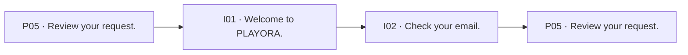

**Branches and guards**

- Google cancellation returns to I01.
- Expired/used code needs a new challenge.
- Catalog/terms changes require revalidation after login.

**Completion evidence:** Same intended custom/package/listing flow restored without secrets in local storage.

## F09 — Separate admin sign-in, enrollment & recovery

[I09](design/index.html#I09/return/A01) → [I02](design/index.html#I02/admin/return/A01) → [I03](design/index.html#I03/admin/return/A01) → [A01](design/index.html#A01)

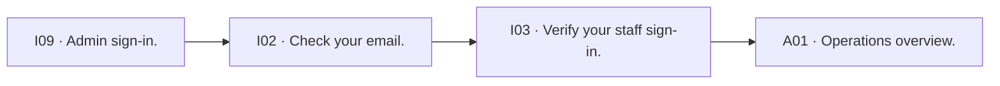

**Branches and guards**

- Every step is explicitly admin-scoped: I02/admin, I03/admin, I04/admin, I05/admin. No customer or booster session reuse.
- Google returns to the admin authenticator check; email first verifies I02/admin. No public staff signup.
- Missing enrollment opens I04/admin after first factor; invalid/expired/recovery states remain in this portal. Recovery code substitutes only the second factor.
- Wrong role or suspension denies entry without creating access. Both-factor success revalidates the permitted admin destination.
- Cancelled or expired verification returns to I09; customer and booster portals remain separate. Sensitive actions return to the exact originating editor and are not auto-confirmed.

**Completion evidence:** Separate authorized admin session only after both factors; safe same-portal return.

## F10 — Profile, identity linking & session revocation

[C01](design/index.html#C01) → [C22](design/index.html#C22) → [C17](design/index.html#C17) → [I07](design/index.html#I07) → [I02](design/index.html#I02) → [C17](design/index.html#C17)

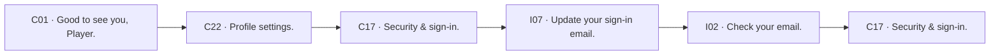

**Branches and guards**

- Google linking verifies both existing and new identities.
- Email conflicts do not reveal account ownership.
- Revoke-all confirmation explains current session will end.
- Panel revision: enter the named record; change local sections without leaving its role/identity; return to the filtered parent list. Admin previews return to the exact originating editor. See PANEL_UX_REVISION.md.

**Completion evidence:** Verified identity changes and accurate session state.

## F11 — Pre-sales and order support

[G01](design/index.html#G01) → [C13](design/index.html#C13) → [I01](design/index.html#I01) → [I02](design/index.html#I02) → [C11](design/index.html#C11) → [C12](design/index.html#C12)

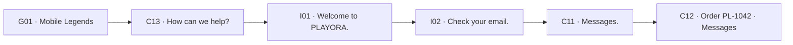

**Branches and guards**

- Draft survives reconnect and failed send.
- New messages do not move a reader looking at history.
- Rejected files keep the text draft.
- Access revocation clears private thread content.
- Panel revision: enter the named record; change local sections without leaving its role/identity; return to the filtered parent list. Admin previews return to the exact originating editor. See PANEL_UX_REVISION.md.

**Completion evidence:** One accessible conversation with known audience and reliable send status.

## F12 — Booster fulfillment & admin completion

[B01](design/index.html#B01) → [B02](design/index.html#B02) → [B03](design/index.html#B03) → [B04](design/index.html#B04) → [B05](design/index.html#B05) → [B03](design/index.html#B03) → [A03](design/index.html#A03) → [C05](design/index.html#C05)

```mermaid
flowchart LR
  n0["B01 · Your next session."]
  n1["B02 · Assigned orders."]
  n2["B03 · PL-1038 · Your assignment"]
  n3["B04 · Availability & sessions."]
  n4["B05 · Assignment messages."]
  n5["B03 · PL-1038 · Your assignment"]
  n6["A03 · Review order PL-1042."]
  n7["C05 · Your boost is in progress."]
  n0 --> n1
  n1 --> n2
  n2 --> n3
  n3 --> n4
  n4 --> n5
  n5 --> n6
  n6 --> n7
```

**Branches and guards**

- Unpaid/missing prerequisites block start.
- Assignment revocation removes access immediately.
- Proof scanning blocks completion submission.
- Booster submits completion; admin approves final completion.
- Panel revision: enter the named record; change local sections without leaving its role/identity; return to the filtered parent list. Admin previews return to the exact originating editor. See PANEL_UX_REVISION.md.

**Completion evidence:** Scoped fulfillment and customer-visible evidence with no pricing/refund authority.

## F13 — Scheduling & rescheduling

[C06](design/index.html#C06) → [B04](design/index.html#B04) → [A07](design/index.html#A07) → [C06](design/index.html#C06)

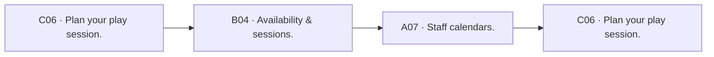

**Branches and guards**

- Conflicts reject stale slot; chosen timezone remains.
- DST ambiguity presents explicit offsets.
- Reschedule keeps previous booking until replacement accepted according to backend.
- Panel revision: enter the named record; change local sections without leaving its role/identity; return to the filtered parent list. Admin previews return to the exact originating editor. See PANEL_UX_REVISION.md.

**Completion evidence:** One valid confirmed booking and visible change history.

## F14 — Catalog, forms, rules & packages

[A10](design/index.html#A10) → [A11](design/index.html#A11) → [A12](design/index.html#A12) → [A13](design/index.html#A13) → [A24](design/index.html#A24) → [A25](design/index.html#A25) → [A14](design/index.html#A14) → [G01](design/index.html#G01)

```mermaid
flowchart LR
  n0["A10 · Game catalog."]
  n1["A11 · Mobile Legends · Game settings"]
  n2["A12 · Build the order form."]
  n3["A13 · Price estimation rules."]
  n4["A24 · Fixed packages editor."]
  n5["A25 · Seller intake & transfer rules."]
  n6["A14 · Preview & publish a release."]
  n7["G01 · Mobile Legends"]
  n0 --> n1
  n1 --> n2
  n2 --> n3
  n3 --> n4
  n4 --> n5
  n5 --> n6
  n6 --> n7
```

**Branches and guards**

- Invalid references/condition cycles block publication.
- Unsaved navigation prompts retain drafts.
- Stale preview/version conflict requires fresh review.
- Archive/pause affect new purchases, not historical snapshots.
- Panel revision: enter the named record; change local sections without leaving its role/identity; return to the filtered parent list. Admin previews return to the exact originating editor. See PANEL_UX_REVISION.md.

**Completion evidence:** A validated versioned release with customer previews.

## F15 — Staff triage, quotes and holds

[A01](design/index.html#A01) → [A02](design/index.html#A02) → [A03](design/index.html#A03) → [A04](design/index.html#A04) → [C03](design/index.html#C03) → [A03](design/index.html#A03)

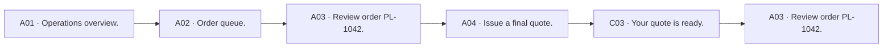

**Branches and guards**

- Clarify/reject needs a customer-visible reason.
- Accepted contract cannot be silently repriced.
- Concurrent status update requires reload/compare.
- Panel revision: enter the named record; change local sections without leaving its role/identity; return to the filtered parent list. Admin previews return to the exact originating editor. See PANEL_UX_REVISION.md.

**Completion evidence:** Correct next action and audited state transition.

## F16 — Staff message vs internal note

[A05](design/index.html#A05) → [A06](design/index.html#A06) → [A03](design/index.html#A03)

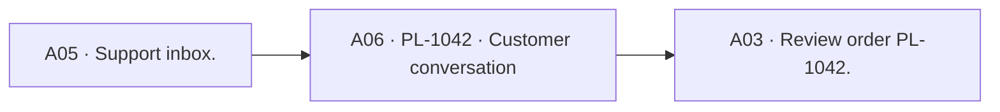

**Branches and guards**

- Audience stays visible through attachment and keyboard states.
- Switching mode with an unsent draft asks where to keep it.
- Buyer and seller conversations remain separate.
- Panel revision: enter the named record; change local sections without leaving its role/identity; return to the filtered parent list. Admin previews return to the exact originating editor. See PANEL_UX_REVISION.md.

**Completion evidence:** Message reaches only its selected authorized audience.

## F17 — Payment and seller-payout operations

[A15](design/index.html#A15) → [A16](design/index.html#A16) → [A17](design/index.html#A17) → [I06](design/index.html#I06) → [A19](design/index.html#A19) → [A31](design/index.html#A31)

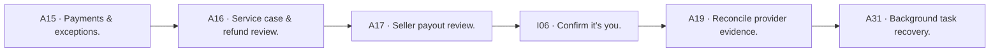

**Branches and guards**

- No manual paid toggle.
- Uncertain transfer reconciles before retry.
- Separate outgoing activation and verified recipient required.
- Panel revision: enter the named record; change local sections without leaving its role/identity; return to the filtered parent list. Admin previews return to the exact originating editor. See PANEL_UX_REVISION.md.

**Completion evidence:** Provider-backed result without duplicate transfer or mixed currencies.

## F18 — Favorites, reorder & availability

[P13](design/index.html#P13) → [C10](design/index.html#C10) → [P04](design/index.html#P04) → [C20](design/index.html#C20) → [C21](design/index.html#C21)

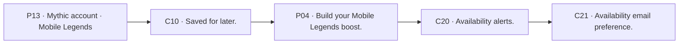

**Branches and guards**

- Reorder validates current options and prices.
- Sold/archived saved item remains understandable.
- Unsubscribe token affects only its intended alert.
- Panel revision: enter the named record; change local sections without leaving its role/identity; return to the filtered parent list. Admin previews return to the exact originating editor. See PANEL_UX_REVISION.md.

**Completion evidence:** Fresh eligible order or explicit alert consent; no reservation from a favorite.

## F19 — Reviews & moderation

[C05](design/index.html#C05) → [C15](design/index.html#C15) → [C16](design/index.html#C16) → [A28](design/index.html#A28) → [A29](design/index.html#A29) → [P15](design/index.html#P15)

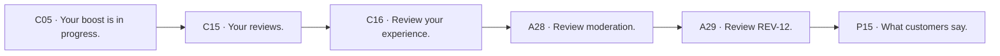

**Branches and guards**

- Eligibility, duplicate and moderation states explicit.
- Customer text is not rewritten to improve sentiment.
- Refund labels remain where required.
- Panel revision: enter the named record; change local sections without leaving its role/identity; return to the filtered parent list. Admin previews return to the exact originating editor. See PANEL_UX_REVISION.md.

**Completion evidence:** Published eligible review or reasoned moderation outcome.

## F20 — Notifications & preferences

[C14](design/index.html#C14) → [C03](design/index.html#C03) → [C19](design/index.html#C19) → [C20](design/index.html#C20)

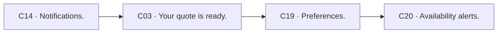

**Branches and guards**

- Read notification does not complete its action.
- Unavailable deep link returns safely.
- Sound is opt-in; reduced motion is honored.
- Panel revision: enter the named record; change local sections without leaving its role/identity; return to the filtered parent list. Admin previews return to the exact originating editor. See PANEL_UX_REVISION.md.

**Completion evidence:** Preferences saved and destination/context preserved.

## F21 — Privacy export and deletion

[C18](design/index.html#C18) → [A36](design/index.html#A36) → [A35](design/index.html#A35) → [I06](design/index.html#I06) → [C18](design/index.html#C18)

```mermaid
flowchart LR
  n0["C18 · Your data & privacy."]
  n1["A36 · Retention policy."]
  n2["A35 · Privacy request review."]
  n3["I06 · Confirm it’s you."]
  n4["C18 · Your data & privacy."]
  n0 --> n1
  n1 --> n2
  n2 --> n3
  n3 --> n4
```

**Branches and guards**

- Owner policy must be published/enabled.
- Active order/dispute holds block erasure.
- Cancellation ends when irreversible erasure begins.
- Live erasure, pending files, retained evidence/backups are distinct.
- Panel revision: enter the named record; change local sections without leaving its role/identity; return to the filtered parent list. Admin previews return to the exact originating editor. See PANEL_UX_REVISION.md.

**Completion evidence:** Truthful deletion/export status under explicit policy.

## F22 — Role, suspension and recovery governance

[A08](design/index.html#A08) → [I06](design/index.html#I06) → [A09](design/index.html#A09) → [A08](design/index.html#A08)

```mermaid
flowchart LR
  n0["A08 · Customers & staff."]
  n1["I06 · Confirm it’s you."]
  n2["A09 · Audit & recovery review."]
  n3["A08 · Customers & staff."]
  n0 --> n1
  n1 --> n2
  n2 --> n3
```

**Branches and guards**

- Last owner cannot be removed.
- Role/suspension change revokes affected sessions as required.
- No public role selection or automatic email-based role grant.
- Panel revision: enter the named record; change local sections without leaving its role/identity; return to the filtered parent list. Admin previews return to the exact originating editor. See PANEL_UX_REVISION.md.

**Completion evidence:** Audited access change and exact affected-session outcome.

## F23 — Policy/coupon publication

[A27](design/index.html#A27) → [A34](design/index.html#A34) → [A18](design/index.html#A18) → [I06](design/index.html#I06) → [P17](design/index.html#P17)

```mermaid
flowchart LR
  n0["A27 · Coupons."]
  n1["A34 · Content & policies."]
  n2["A18 · Payment policy."]
  n3["I06 · Confirm it’s you."]
  n4["P17 · Service terms & privacy."]
  n0 --> n1
  n1 --> n2
  n2 --> n3
  n3 --> n4
```

**Branches and guards**

- Historical agreements stay immutable.
- Incomplete commercial terms block related purchases.
- Coupons cannot produce invalid totals or unsupported scope.
- Panel revision: enter the named record; change local sections without leaving its role/identity; return to the filtered parent list. Admin previews return to the exact originating editor. See PANEL_UX_REVISION.md.

**Completion evidence:** Published explicit version; preview and customer terms agree.

## F24 — Reports, media, alerts and job recovery

[A30](design/index.html#A30) → [A32](design/index.html#A32) → [A33](design/index.html#A33) → [A31](design/index.html#A31)

```mermaid
flowchart LR
  n0["A30 · Reports."]
  n1["A32 · Media directory."]
  n2["A33 · Availability alert management."]
  n3["A31 · Background task recovery."]
  n0 --> n1
  n1 --> n2
  n2 --> n3
```

**Branches and guards**

- Stale report preview needs regeneration.
- Rejected/quarantined files never render public previews.
- Retry queues a job, not a payment success.
- Panel revision: enter the named record; change local sections without leaving its role/identity; return to the filtered parent list. Admin previews return to the exact originating editor. See PANEL_UX_REVISION.md.

**Completion evidence:** Scoped evidence/export and truthful recovery status.

## F25 — Global recovery

[X01](design/index.html#X01) → [I01](design/index.html#I01) → [C01](design/index.html#C01)

```mermaid
flowchart LR
  n0["X01 · This page isn’t available."]
  n1["I01 · Welcome to PLAYORA."]
  n2["C01 · Good to see you, Player."]
  n0 --> n1
  n1 --> n2
```

**Branches and guards**

- 404 and access denial do not disclose private object existence.
- Offline recovery retains only safe drafts.
- Rate limits use server-provided retry information.
- Panel revision: enter the named record; change local sections without leaving its role/identity; return to the filtered parent list. Admin previews return to the exact originating editor. See PANEL_UX_REVISION.md.

**Completion evidence:** Safe navigation without leaking private content or losing permitted drafts.

## F26 — World of Warcraft configurable-service template

[P02](design/index.html#P02) → [G02](design/index.html#G02) → [G07](design/index.html#G07) → [G12](design/index.html#G12) → [I01](design/index.html#I01) → [I02](design/index.html#I02) → [G12](design/index.html#G12)

```mermaid
flowchart LR
  n0["P02 · Find your game."]
  n1["G02 · World of Warcraft"]
  n2["G07 · Build your World of Warcraft request."]
  n3["G12 · Review your World of Warcraft request."]
  n4["I01 · Welcome to PLAYORA."]
  n5["I02 · Check your email."]
  n6["G12 · Review your World of Warcraft request."]
  n0 --> n1
  n1 --> n2
  n2 --> n3
  n3 --> n4
  n4 --> n5
  n5 --> n6
```

**Branches and guards**

- This is a future-game design template, not launch availability.
- Use the game-specific fields shown in this template; no hard-coded season or live price.
- After successful submission, use F01 order/quote/payment/fulfillment screens with this game context retained.
- Invalid or unpublished configuration blocks new ordering, without affecting history.

**Completion evidence:** Reviewed game-specific configuration, followed by the shared custom-quote journey when the catalog is published.

## F27 — League of Legends configurable-service template

[P02](design/index.html#P02) → [G03](design/index.html#G03) → [G08](design/index.html#G08) → [G13](design/index.html#G13) → [I01](design/index.html#I01) → [I02](design/index.html#I02) → [G13](design/index.html#G13)

```mermaid
flowchart LR
  n0["P02 · Find your game."]
  n1["G03 · League of Legends"]
  n2["G08 · Build your League of Legends request."]
  n3["G13 · Review your League of Legends request."]
  n4["I01 · Welcome to PLAYORA."]
  n5["I02 · Check your email."]
  n6["G13 · Review your League of Legends request."]
  n0 --> n1
  n1 --> n2
  n2 --> n3
  n3 --> n4
  n4 --> n5
  n5 --> n6
```

**Branches and guards**

- This is a future-game design template, not launch availability.
- Use the game-specific fields shown in this template; no hard-coded season or live price.
- After successful submission, use F01 order/quote/payment/fulfillment screens with this game context retained.
- Invalid or unpublished configuration blocks new ordering, without affecting history.

**Completion evidence:** Reviewed game-specific configuration, followed by the shared custom-quote journey when the catalog is published.

## F28 — VALORANT configurable-service template

[P02](design/index.html#P02) → [G04](design/index.html#G04) → [G09](design/index.html#G09) → [G14](design/index.html#G14) → [I01](design/index.html#I01) → [I02](design/index.html#I02) → [G14](design/index.html#G14)

```mermaid
flowchart LR
  n0["P02 · Find your game."]
  n1["G04 · VALORANT"]
  n2["G09 · Build your VALORANT request."]
  n3["G14 · Review your VALORANT request."]
  n4["I01 · Welcome to PLAYORA."]
  n5["I02 · Check your email."]
  n6["G14 · Review your VALORANT request."]
  n0 --> n1
  n1 --> n2
  n2 --> n3
  n3 --> n4
  n4 --> n5
  n5 --> n6
```

**Branches and guards**

- This is a future-game design template, not launch availability.
- Use the game-specific fields shown in this template; no hard-coded season or live price.
- After successful submission, use F01 order/quote/payment/fulfillment screens with this game context retained.
- Invalid or unpublished configuration blocks new ordering, without affecting history.

**Completion evidence:** Reviewed game-specific configuration, followed by the shared custom-quote journey when the catalog is published.

## F29 — Dota 2 configurable-service template

[P02](design/index.html#P02) → [G05](design/index.html#G05) → [G10](design/index.html#G10) → [G15](design/index.html#G15) → [I01](design/index.html#I01) → [I02](design/index.html#I02) → [G15](design/index.html#G15)

```mermaid
flowchart LR
  n0["P02 · Find your game."]
  n1["G05 · Dota 2"]
  n2["G10 · Build your Dota 2 request."]
  n3["G15 · Review your Dota 2 request."]
  n4["I01 · Welcome to PLAYORA."]
  n5["I02 · Check your email."]
  n6["G15 · Review your Dota 2 request."]
  n0 --> n1
  n1 --> n2
  n2 --> n3
  n3 --> n4
  n4 --> n5
  n5 --> n6
```

**Branches and guards**

- This is a future-game design template, not launch availability.
- Use the game-specific fields shown in this template; no hard-coded season or live price.
- After successful submission, use F01 order/quote/payment/fulfillment screens with this game context retained.
- Invalid or unpublished configuration blocks new ordering, without affecting history.

**Completion evidence:** Reviewed game-specific configuration, followed by the shared custom-quote journey when the catalog is published.

## F30 — Wild Rift configurable-service template

[P02](design/index.html#P02) → [G06](design/index.html#G06) → [G11](design/index.html#G11) → [G16](design/index.html#G16) → [I01](design/index.html#I01) → [I02](design/index.html#I02) → [G16](design/index.html#G16)

```mermaid
flowchart LR
  n0["P02 · Find your game."]
  n1["G06 · Wild Rift"]
  n2["G11 · Build your Wild Rift request."]
  n3["G16 · Review your Wild Rift request."]
  n4["I01 · Welcome to PLAYORA."]
  n5["I02 · Check your email."]
  n6["G16 · Review your Wild Rift request."]
  n0 --> n1
  n1 --> n2
  n2 --> n3
  n3 --> n4
  n4 --> n5
  n5 --> n6
```

**Branches and guards**

- This is a future-game design template, not launch availability.
- Use the game-specific fields shown in this template; no hard-coded season or live price.
- After successful submission, use F01 order/quote/payment/fulfillment screens with this game context retained.
- Invalid or unpublished configuration blocks new ordering, without affecting history.

**Completion evidence:** Reviewed game-specific configuration, followed by the shared custom-quote journey when the catalog is published.

## F31 — Separate booster sign-in, enrollment & recovery

[I10](design/index.html#I10/return/B01) → [I02](design/index.html#I02/booster/return/B01) → [I03](design/index.html#I03/booster/return/B01) → [B01](design/index.html#B01)

```mermaid
flowchart LR
  n0["I10 · Booster sign-in."]
  n1["I02 · Check your email."]
  n2["I03 · Verify your staff sign-in."]
  n3["B01 · Your next session."]
  n0 --> n1
  n1 --> n2
  n2 --> n3
```

**Branches and guards**

- Every step is explicitly booster-scoped: I02/booster, I03/booster, I04/booster, I05/booster. No customer or admin session reuse.
- Google returns to the booster authenticator check; email first verifies I02/booster. No public staff signup.
- Missing enrollment opens I04/booster after first factor; invalid/expired/recovery states remain in this portal. Recovery code substitutes only the second factor.
- Wrong role or suspension denies entry without creating access. Both-factor success revalidates the permitted booster destination.
- Cancelled or expired verification returns to I10; customer and admin portals remain separate. Sensitive actions return to the exact originating editor and are not auto-confirmed.

**Completion evidence:** Separate authorized booster session only after both factors; assigned-workspace return.
