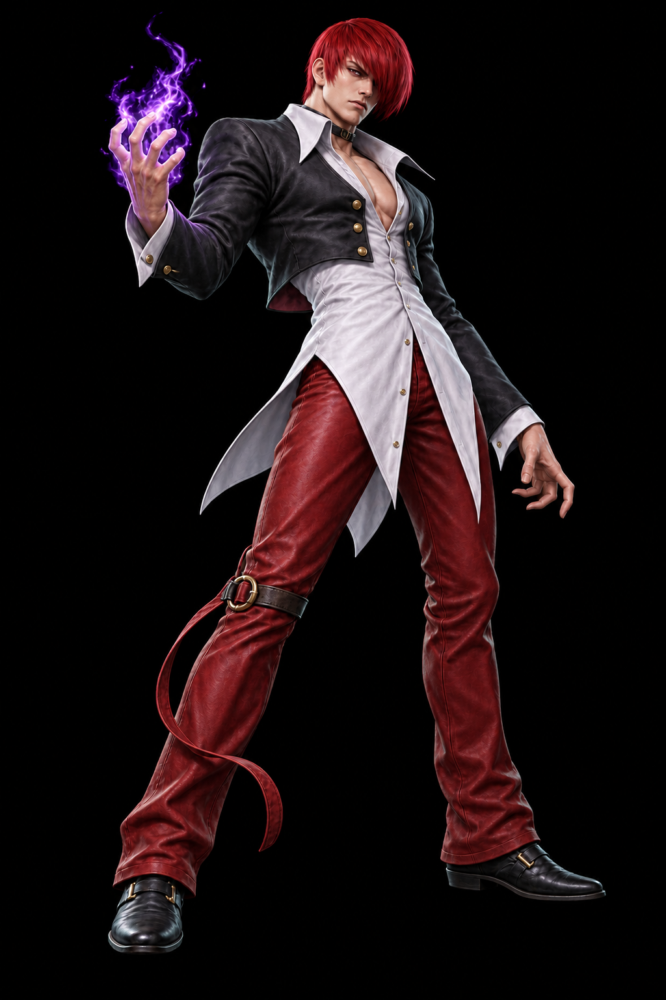
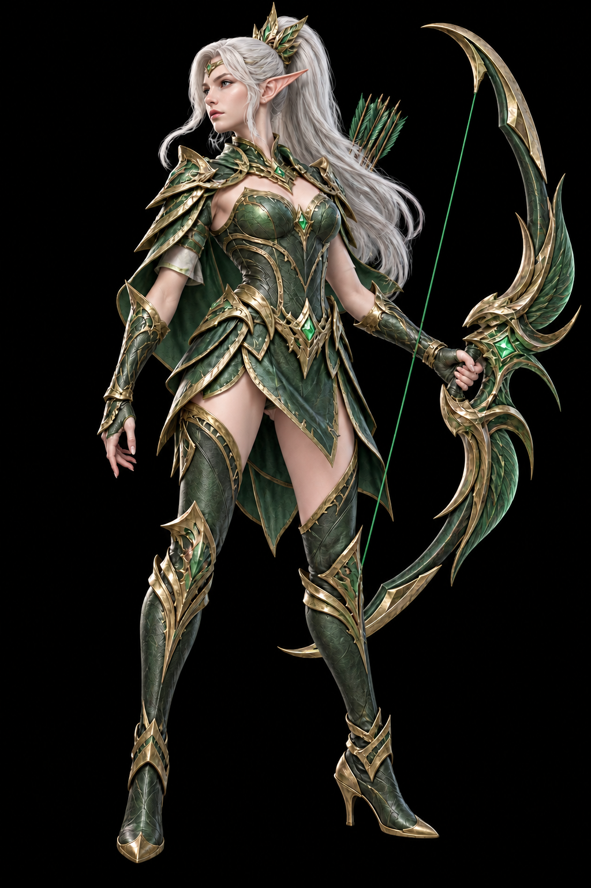
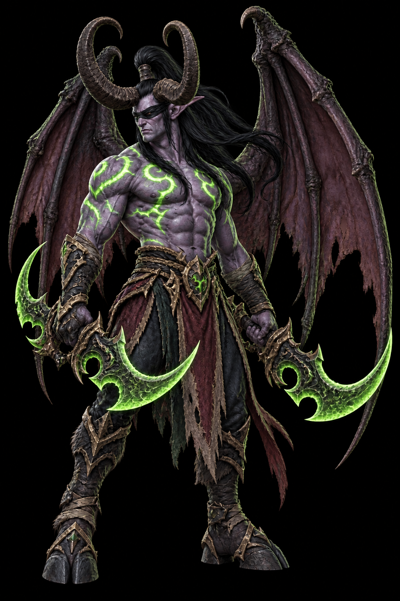
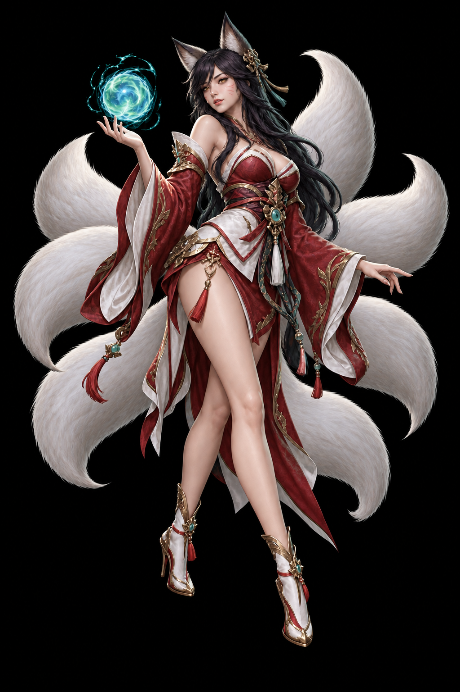

# HF02 — Existing artwork contact sheet

14 September 2026. This compares existing PLAYORA assets; it does not introduce new character artwork or qualify animation. The original hero scene stays. The hero's separate Iori overlay is removed. The three showcase selections remain while HF03 qualifies a better motion treatment.

| Existing asset | Composition decision | Motion work still required |
| --- | --- | --- |
| [Original ascension scene](../../frontend/public/artwork/ascension-1536.jpg) | Hero alone; the winged crest is the focal point to the right of the headline. Preserve the green/gold palette. | Keep the artwork stable while reading; rank transformation remains a separate section. |
| [Iori / Chou](../brand/playora/characters/iori.png) | Remove from hero. Keep the MLBB showcase selection for comparison with Miya during HF03. | Replace the current coarse image partition with coherent internal motion; preserve the silhouette and coat joins. |
| [Miya candidate](../brand/playora/characters/miya.png) | Green/gold costume fits the brand and a quieter showcase. The pale hair provides contrast; bow and hair provide useful secondary movement. Existing concept art is a candidate, not newly approved final game media. | Qualify clean hair/cape layers and breathing without warping the face, bow or hand. Do not derive walking or an authentic voiced skill from this still alone. |
| [Illidan / WoW](../brand/playora/characters/illidan.png) | Keep the separate game's silhouette; leave enough space around wings and weapon. | Qualify wing/cloth motion without detaching joints or clipping extremities. |
| [Ahri / LoL](../brand/playora/characters/ahri.png) | Keep a third game selection; lighting should support the green scene without recoloring identity cues. | Qualify tail/hair motion and face stability independently. |

## Side-by-side character masters

<table>
<tr><th>MLBB · Iori / Chou</th><th>MLBB · Miya candidate</th><th>WoW · Illidan</th><th>LoL · Ahri</th></tr>
<tr>
<td></td>
<td></td>
<td></td>
<td></td>
</tr>
</table>

These black-background masters are not clean independent animation layers. Authentic punch/voice and skill media remain separate dependencies for HF04A/HF04B. The contact sheet does not claim those assets exist.
